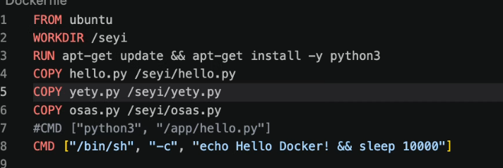

## What problem is docker solving?
## Linux isolating processes.

### Volume mapping



### Port mapping
- Instance of running postgres: refer to postgres docker documentation

###


``` task
- build a docker postgres database, write some data to it and automate the ingestion with cron.

- persist the database such that the container is always restarted but the data is still accessible from the bind mount

- build another container that is not persisted to note the difference in data persistence.
```